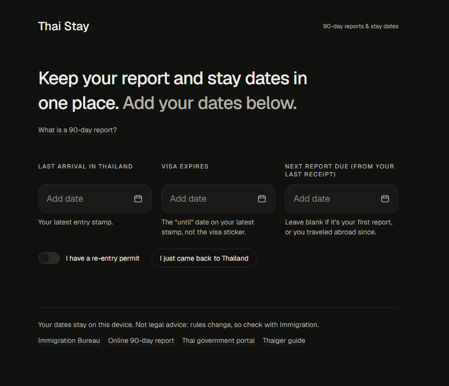

# Thai Stay

A small app I built to keep track of my 90-day reports and permitted stay in Thailand. As an international student studying abroad at Mae Fah Luang University, I wanted something I could use myself and share with friends and juniors who are still getting used to the process.

Hosted in vercel for daily use for those who wanna try **[Open Thai Stay](https://thai-stay-one.vercel.app)**

Enter your latest arrival date, the permitted-until date from your passport stamp, and the next report date from your receipt if you have one. The app puts them on a timeline, shows what's coming up, and lets you add reminders to Google Calendar, Apple Calendar, or Outlook.



*Full-page preview with example dates.*

You can also:

- Update your dates after filing a report or returning to Thailand.
- Check the included immigration offices and open directions.
- Read short guides with links to their sources.
- See weekend and holiday notices alongside your deadlines.

Your dates stay in this browser; there's no account to create. Clearing browser data can remove them, so add important dates to your calendar too. Later reports on the timeline are estimates, and the office and holiday lists have limited coverage.

I built it with **Next.js, React, TypeScript, Tailwind CSS, and date-fns**, and deployed it on Vercel. The date calculations live separately from the UI in `src/lib/`, with Vitest tests for deadlines, travel updates, and calendar exports.

## Run locally

```bash
npm install
npm run dev
```

Open [localhost:3000](http://localhost:3000). Use `npm test -- --run` to run the tests or `npm run build` for a production build.

This is a personal reminder tool, not an official immigration service. Check your paperwork and confirm current requirements with Immigration; the app's estimates don't replace them.
